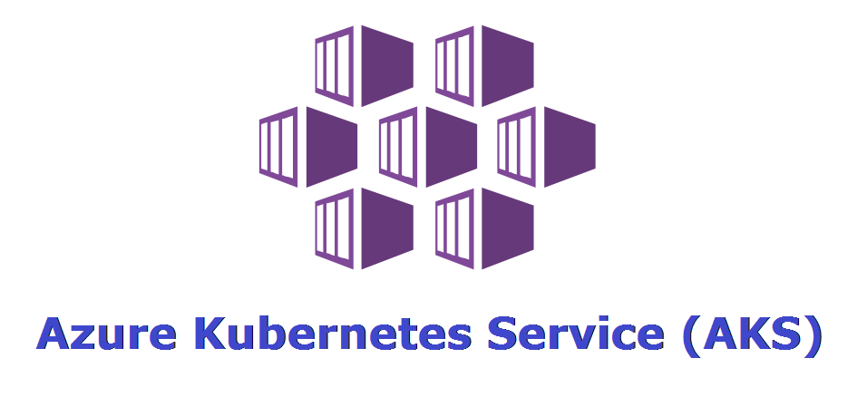
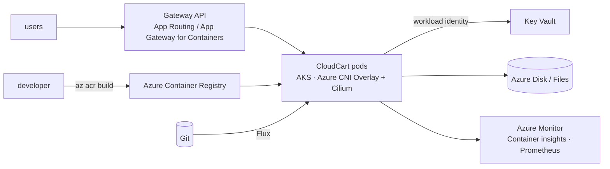

# Kubernetes on Microsoft Azure (AKS) – Hands-on Labs



Fifteen labs that take **CloudCart**, a small online-shop API, from a container image to a secured, observable, GitOps-managed application on Azure Kubernetes Service. One cluster is created in LAB02 and reused until the end – each lab adds a layer.



## Labs

| # | Lab | You will… | Time |
|---|---|---|---|
| 01 | [Containers & ACR](labs/LAB01-containers-acr/README.md) | build a secure image with ACR Tasks | 30 min |
| 02 | [Create AKS](labs/LAB02-create-aks/README.md) | create the course cluster with the CLI, deploy from ACR, node pools | 45 min |
| 03 | [Services & load balancers](labs/LAB03-services-load-balancers/README.md) | public/internal LB, static IP + DNS label, egress IP | 35 min |
| 04 | [Gateway API](labs/LAB04-gateway-api/README.md) | App Routing (Istio-based) Gateway, path routing, canary | 40 min |
| 05 | [TLS with cert-manager](labs/LAB05-tls-cert-manager/README.md) | Let's Encrypt certificates on the Gateway, HTTPS redirect | 40 min |
| 06 | [App Gateway for Containers](labs/LAB06-app-gateway-for-containers/README.md) | ALB Controller, managed AGC, traffic split | 45 min |
| 07 | [Network policies](labs/LAB07-network-policies/README.md) | zero trust between pods with Cilium | 35 min |
| 08 | [Kubeconfig, users & RBAC](labs/LAB08-kubeconfig-users-rbac/README.md) | local accounts, certificate users, Roles and bindings | 35 min |
| 09 | [Entra ID & Azure RBAC](labs/LAB09-entra-id-azure-rbac/README.md) | Entra authentication, Azure RBAC per namespace, disable local accounts | 40 min |
| 10 | [Workload Identity & Key Vault](labs/LAB10-workload-identity-keyvault/README.md) | secretless access to Azure, Secrets Store CSI driver | 40 min |
| 11 | [Storage](labs/LAB11-storage/README.md) | Azure Disk StatefulSet, volume expansion, shared Azure Files | 35 min |
| 12 | [Monitoring & autoscaling](labs/LAB12-monitoring-autoscaling/README.md) | Container insights, control-plane logs, HPA, cluster autoscaler, KQL | 45 min |
| 13 | [GitOps with Flux](labs/LAB13-gitops-flux/README.md) | Flux extension, reconcile from Git, drift healing | 40 min |
| 14 | [CI/CD pipeline](labs/LAB14-cicd-pipeline/README.md) | Azure DevOps or GitHub Actions → ACR → Helm → AKS, secretless | 45 min |
| 15 | [Troubleshooting](labs/LAB15-troubleshooting/README.md) | eight broken workloads, scored automatically | 40 min |

## Prerequisites

- An Azure subscription where you are **Owner** of a resource group (role assignments are part of the labs) and quota for ~8 vCPUs in the chosen region (LAB02 shows how to pick a VM size your subscription allows)
- **Azure Cloud Shell (Bash)** – recommended, everything is pre-installed – or locally: Azure CLI 2.70+, `kubectl`, `kubelogin`, `helm` 3, `git`, `envsubst` (`gettext-base`), `openssl`
- LAB09: an Entra ID group for cluster admins (or permission to create one) and a lab partner
- LAB13/14: a GitHub account (public fork) or an Azure DevOps project

## Getting started

```bash
git clone <this repository> aks-labs && cd aks-labs
source env.sh          # in every new shell - sets RG, CLUSTER, ACR, KV, LOCATION ...
```

Override defaults before sourcing, e.g. `LOCATION=northeurope NODE_SIZE=Standard_D2as_v5 source env.sh`.

## Cost

The lab cluster (3 × D2s_v5 at peak), ACR Basic, Key Vault and Log Analytics cost a few euros per day. Stop the cluster overnight (`az aks stop -g $RG -n $CLUSTER`) and delete everything at the end:

```bash
az group delete -n $RG --yes --no-wait
```

## Repository layout

```
app/              CloudCart API (Node.js 22) + Dockerfile
labs/LABnn-*/     instructions and manifests per lab
charts/cloudcart/ Helm chart used by the CI/CD lab
gitops/           Flux-managed configuration (LAB13)
pipelines/        Azure DevOps and GitHub Actions pipelines (LAB14)
break-fix/        LAB15 scenarios and scoring script
env.sh            lab variables
```

## License

MIT – see [LICENSE](LICENSE).
