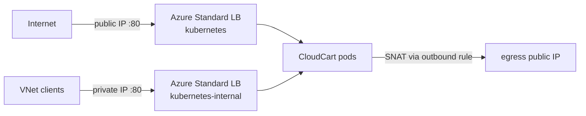

# LAB 03 – Services, Azure Load Balancer & egress

> **Story:** Marketing wants a quick public demo of CloudCart, the ERP team needs it on a private IP inside the VNet, and the payment provider asks: *"Which IP address will your calls come from?"*

| | |
|---|---|
| **Duration** | ~35 min |
| **Files** | `lb-public.yaml`, `lb-internal.yaml`, `lb-static-ip.yaml` |



## Step 1 – Public LoadBalancer Service

```bash
source env.sh
kubectl apply -f labs/LAB03-services-load-balancers/lb-public.yaml
kubectl -n cloudcart get svc cloudcart-public -w          # wait for EXTERNAL-IP, Ctrl+C
curl -s http://$(kubectl -n cloudcart get svc cloudcart-public -o jsonpath='{.status.loadBalancer.ingress[0].ip}')
```

In the node resource group, open the load balancer **kubernetes**: find the new frontend IP, the load-balancing rule for port 80 and the health probe.

## Step 2 – Internal LoadBalancer

```bash
kubectl apply -f labs/LAB03-services-load-balancers/lb-internal.yaml
kubectl -n cloudcart get svc cloudcart-internal -w
```

✅ **Checkpoint:** EXTERNAL-IP is a **private** address from the node subnet (e.g. `10.224.0.x`); a second load balancer **kubernetes-internal** appears in the node resource group.

Test from inside the cluster (there is no VM in the VNet):

```bash
ILB=$(kubectl -n cloudcart get svc cloudcart-internal -o jsonpath='{.status.loadBalancer.ingress[0].ip}')
kubectl run tmp --rm -it --image=curlimages/curl --restart=Never -- curl -s http://$ILB
```

## Step 3 – Static public IP with a DNS name

A Service's IP changes when the Service is recreated. For stable endpoints create the IP yourself:

```bash
MC_RG=$(az aks show -g $RG -n $CLUSTER --query nodeResourceGroup -o tsv)
az network public-ip create -g $MC_RG -n pip-cloudcart --sku Standard --allocation-method Static
export PIP_NAME=pip-cloudcart
envsubst < labs/LAB03-services-load-balancers/lb-static-ip.yaml | kubectl apply -f -
kubectl -n cloudcart get svc cloudcart-static -w
curl -s http://$APP_HOST | head -5
```

✅ **Checkpoint:** the service uses `pip-cloudcart`, and `http://cloudcart-<…>.<region>.cloudapp.azure.com` answers (annotation `azure-dns-label-name`).

> The IP lives in the node resource group, so the cluster identity can use it. For an IP in another resource group grant the cluster identity *Network Contributor* there and add the annotation `service.beta.kubernetes.io/azure-load-balancer-resource-group`. The old `spec.loadBalancerIP` field is deprecated – use the annotations.

## Step 4 – Which IP do my pods use for egress?

```bash
kubectl run egress --rm -it --image=curlimages/curl --restart=Never -- curl -s https://ifconfig.me; echo
az network public-ip show --ids $(az aks show -g $RG -n $CLUSTER \
  --query "networkProfile.loadBalancerProfile.effectiveOutboundIPs[0].id" -o tsv) --query ipAddress -o tsv
```

✅ **Checkpoint:** both commands print the **same** IP – the outbound rule of the Standard Load Balancer SNATs all pod traffic to it. Tell the payment provider to allow-list it.

Discussion: SNAT port exhaustion, `--load-balancer-managed-outbound-ip-count`, NAT Gateway (`--outbound-type managedNATGateway`), or UDR through Azure Firewall (`--outbound-type userDefinedRouting`) for inspected egress.

## Step 5 – Clean up the extra Services

Keep the ClusterIP service – it is used by the ingress labs:

```bash
kubectl -n cloudcart delete svc cloudcart-public cloudcart-internal cloudcart-static
az network public-ip delete -g $MC_RG -n pip-cloudcart
```

## Troubleshooting

| Symptom | Likely cause |
|---|---|
| EXTERNAL-IP stays `<pending>` | `kubectl -n cloudcart describe svc …` – events show quota, IP or permission errors |
| `DNS label … already in use` | label must be unique in the region – change `DNS_LABEL` in `env.sh` |
| curl to the public IP times out | NSG rules on the node subnet, or pods not ready (`kubectl get endpointslices -n cloudcart`) |
