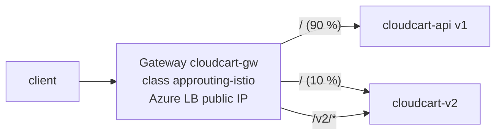

# LAB 04 – Ingress with the Gateway API (App Routing)

> **Story:** One public IP per Service doesn't scale and costs money. CloudCart needs one entry point with path routing – and a safe way to roll out version 2 to 10 % of users first. The community ingress-nginx project was retired in March 2026, so you go straight to the **Gateway API** with the AKS **application routing** add-on.

| | |
|---|---|
| **Duration** | ~40 min |
| **Files** | `cloudcart-v2.yaml`, `gateway.yaml`, `httproute.yaml`, `httproute-canary.yaml` |



| Resource | Owner | Purpose |
|---|---|---|
| `GatewayClass` | provided by AKS | which implementation (`approuting-istio`) |
| `Gateway` | platform team | listeners: ports, protocols, hostnames, TLS |
| `HTTPRoute` | app team | paths, headers, weights → Services |

## Step 1 – Enable the managed Gateway API

```bash
source env.sh
az aks update -g $RG -n $CLUSTER --enable-gateway-api --enable-app-routing-istio
kubectl get crd | grep gateway.networking.k8s.io
kubectl get gatewayclass
```

✅ **Checkpoint:** CRDs `gateways`, `httproutes`, `grpcroutes` … exist and the GatewayClass **`approuting-istio`** is `Accepted`.

## Step 2 – A second version of the app

```bash
envsubst < labs/LAB04-gateway-api/cloudcart-v2.yaml | kubectl apply -f -
kubectl -n cloudcart get deploy,svc
```

## Step 3 – The Gateway

```bash
kubectl apply -f labs/LAB04-gateway-api/gateway.yaml
kubectl -n cloudcart get gateway cloudcart-gw -w     # wait for PROGRAMMED=True, Ctrl+C
kubectl -n cloudcart get pods,svc                    # the implementation deployed gateway pods + a LoadBalancer Service
export GW_IP=$(kubectl -n cloudcart get gateway cloudcart-gw -o jsonpath='{.status.addresses[0].value}')
echo $GW_IP
```

## Step 4 – Routes

```bash
kubectl apply -f labs/LAB04-gateway-api/httproute.yaml
curl -s http://$GW_IP/            | grep version     # 1.0
curl -s http://$GW_IP/v2/products | grep -E 'version|path'   # 2.0, path rewritten to /products
curl -s -H "X-Canary: true" http://$GW_IP/ | grep version     # 2.0 (header match)
```

✅ **Checkpoint:** `/` → v1, `/v2/...` → v2 with the prefix removed, header `X-Canary: true` → v2.

## Step 5 – Canary: 90 / 10 traffic split

```bash
kubectl apply -f labs/LAB04-gateway-api/httproute-canary.yaml
for i in $(seq 1 50); do curl -s http://$GW_IP/ | grep -o '"version": "[0-9.]*"'; done | sort | uniq -c
```

✅ **Checkpoint:** roughly 45 × `1.0`, 5 × `2.0`. Change the weights to 50/50, then 0/100 – a full rollout without touching DNS or Services.

## Step 6 – Status and troubleshooting

```bash
kubectl -n cloudcart describe httproute cloudcart-routes | sed -n '/Status/,$p'
kubectl -n cloudcart get gateway cloudcart-gw -o yaml | sed -n '/status:/,$p'
```

Break it on purpose: change a `backendRefs` service name to `nope`, apply, and read the `ResolvedRefs` condition. Fix it again.

## Discussion

- Gateway API vs. Ingress: roles, portability, typed fields instead of annotations.
- Other Gateway API implementations on AKS: Application Gateway for Containers (LAB06), Istio service mesh add-on, Cilium, Envoy Gateway, NGINX Gateway Fabric.
- Still on Ingress resources? The AKS managed NGINX of the application routing add-on is supported until **November 2026** – plan the migration now.

## Troubleshooting

| Symptom | Likely cause |
|---|---|
| no GatewayClass | add-on update still running – `az aks show -g $RG -n $CLUSTER --query ingressProfile` |
| Gateway `PROGRAMMED=False` | wrong `gatewayClassName`, or public IP quota |
| `404` from the gateway | no route matches – check hostnames/paths and `parentRefs` |
| `ResolvedRefs=False` | backend Service name/port wrong, or in another namespace without a ReferenceGrant |
