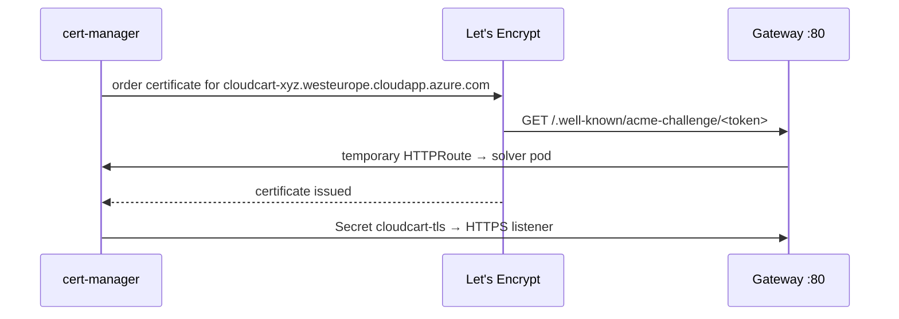

# LAB 05 – HTTPS with cert-manager & Let's Encrypt

> **Story:** The payment provider refuses plain HTTP. CloudCart needs a real DNS name and a trusted certificate that renews itself.

| | |
|---|---|
| **Duration** | ~40 min |
| **Builds on** | LAB04 (Gateway `cloudcart-gw`) |
| **Files** | `gateway-tls.yaml`, `clusterissuer.yaml`, `httproute-redirect.yaml` |



## Step 1 – A DNS name for the Gateway

Azure gives every public IP an optional DNS label: `<label>.<region>.cloudapp.azure.com`. The Gateway API passes annotations to the generated LoadBalancer Service via `spec.infrastructure`.

```bash
source env.sh
echo $APP_HOST
envsubst < labs/LAB05-tls-cert-manager/gateway-tls.yaml | kubectl apply -f -
```

`gateway-tls.yaml` updates `cloudcart-gw`: DNS label annotation, an HTTPS listener for `$APP_HOST` referencing the Secret `cloudcart-tls`, and the annotation `cert-manager.io/cluster-issuer`.

```bash
nslookup $APP_HOST                     # resolves to the gateway IP (may take a minute)
curl -s http://$APP_HOST/ | grep version
```

## Step 2 – Install cert-manager

```bash
helm install cert-manager oci://quay.io/jetstack/charts/cert-manager \
  --version $CERT_MANAGER_VERSION \
  --namespace cert-manager --create-namespace \
  --set crds.enabled=true \
  --set config.enableGatewayAPI=true
kubectl -n cert-manager get pods
```

`config.enableGatewayAPI=true` lets cert-manager read Gateways and create HTTPRoutes for ACME challenges.

## Step 3 – ClusterIssuers (staging first!)

Let's Encrypt production has strict rate limits. Always test with **staging**:

```bash
export ACME_EMAIL=<your e-mail>
envsubst < labs/LAB05-tls-cert-manager/clusterissuer.yaml | kubectl apply -f -
kubectl get clusterissuer
```

✅ **Checkpoint:** `letsencrypt-staging` and `letsencrypt-prod` are `READY=True`.

## Step 4 – Watch the certificate being issued

The Gateway is annotated with `letsencrypt-staging`, so cert-manager creates a `Certificate` automatically:

```bash
kubectl -n cloudcart get certificate,certificaterequest,order,challenge
kubectl -n cloudcart describe challenge          # while it is pending
kubectl -n cloudcart get httproute               # the temporary solver route
kubectl -n cloudcart get certificate cloudcart-tls -w   # READY=True after ~1 min
curl -sk https://$APP_HOST/ | grep version
curl -sv https://$APP_HOST/ 2>&1 | grep -i "issuer"      # (STAGING) Let's Encrypt
```

## Step 5 – Production certificate

```bash
kubectl -n cloudcart annotate gateway cloudcart-gw cert-manager.io/cluster-issuer=letsencrypt-prod --overwrite
kubectl -n cloudcart delete secret cloudcart-tls          # force re-issue
kubectl -n cloudcart get certificate cloudcart-tls -w
curl -s https://$APP_HOST/ | grep version                 # no -k: trusted!
```

## Step 6 – Redirect HTTP to HTTPS

```bash
kubectl apply -f labs/LAB05-tls-cert-manager/httproute-redirect.yaml
kubectl -n cloudcart patch httproute cloudcart-routes --type=json \
  -p='[{"op":"replace","path":"/spec/parentRefs/0/sectionName","value":"https"}]'
curl -sI http://$APP_HOST/ | head -3          # 301 → https
curl -s https://$APP_HOST/v2/ | grep version  # routes now served on HTTPS
```

ACME renewals keep working: cert-manager's challenge route matches the exact `/.well-known/acme-challenge/…` path, which wins over the redirect's `/` prefix.

## Discussion

- Certificates in Azure Key Vault instead of cert-manager? (App Routing operator, AGC, Key Vault CSI)
- Wildcard certificates need **DNS-01** – cert-manager with Azure DNS and workload identity.
- Who owns the Gateway (platform) vs. the routes (apps)? How does `allowedRoutes` enforce it?

## Troubleshooting

| Symptom | Likely cause |
|---|---|
| Challenge `pending`, `connection refused` / `404` | DNS name not resolving yet, or the HTTP listener missing |
| `Certificate` never created | cert-manager installed without `config.enableGatewayAPI=true`, or annotation missing on the Gateway |
| `too many certificates already issued` | you used prod too often – switch to staging |
| browser warns about the certificate | still the staging issuer (Step 5 not done) |
