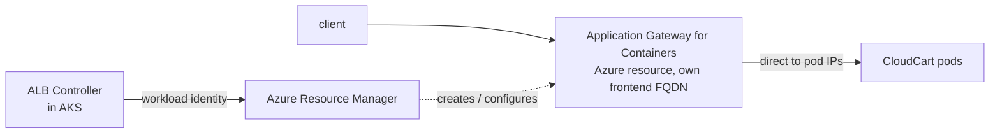

# LAB 06 – Application Gateway for Containers

> **Story:** Security wants CloudCart behind a managed Azure layer-7 load balancer that lives **outside** the cluster, scales on its own and can later get a WAF. That's **Application Gateway for Containers (AGC)** – Azure's Gateway API implementation and the successor to the Application Gateway Ingress Controller (AGIC).

| | |
|---|---|
| **Duration** | ~45 min |
| **Creates** | managed identity, delegated subnet, ALB Controller (Helm), AGC resource (created by the controller) |
| **Files** | `alb.yaml`, `gateway-agc.yaml`, `httproute-agc.yaml` |



**Managed deployment:** you only create Kubernetes objects (`ApplicationLoadBalancer`, `Gateway`, `HTTPRoute`); the ALB Controller creates and configures the Azure resources.

## Step 1 – Providers and variables

```bash
source env.sh
for ns in Microsoft.ContainerService Microsoft.Network Microsoft.NetworkFunction Microsoft.ServiceNetworking; do
  az provider register --namespace $ns
done
MC_RG=$(az aks show -g $RG -n $CLUSTER --query nodeResourceGroup -o tsv)
MC_RG_ID=$(az group show -n $MC_RG --query id -o tsv)
OIDC=$(az aks show -g $RG -n $CLUSTER --query oidcIssuerProfile.issuerUrl -o tsv)
```

## Step 2 – Identity for the ALB Controller (workload identity)

```bash
az identity create -g $RG -n azure-alb-identity
ALB_PRINCIPAL=$(az identity show -g $RG -n azure-alb-identity --query principalId -o tsv)
ALB_CLIENT_ID=$(az identity show -g $RG -n azure-alb-identity --query clientId -o tsv)

# Reader on the node resource group
az role assignment create --assignee-object-id $ALB_PRINCIPAL --assignee-principal-type ServicePrincipal \
  --scope $MC_RG_ID --role "acdd72a7-3385-48ef-bd42-f606fba81ae7"

# trust tokens of the controller's service account (the name azure-alb-identity is required)
az identity federated-credential create -g $RG --identity-name azure-alb-identity \
  --name azure-alb-identity --issuer $OIDC \
  --subject system:serviceaccount:azure-alb-system:alb-controller-sa
```

## Step 3 – Install the ALB Controller

```bash
helm install alb-controller oci://mcr.microsoft.com/application-lb/charts/alb-controller \
  --namespace azure-alb-system --create-namespace \
  --version $ALB_CONTROLLER_VERSION \
  --set albController.namespace=azure-alb-system \
  --set albController.podIdentity.clientID=$ALB_CLIENT_ID \
  --set albController.installGatewayApiCRDs=false
kubectl -n azure-alb-system rollout status deploy/alb-controller --timeout=180s
kubectl get gatewayclass azure-alb-external
```

`installGatewayApiCRDs=false`: the Gateway API CRDs are already installed and **managed by AKS** since LAB04 (`--enable-gateway-api`). Two owners of the same CRDs don't mix – without this flag the controller's init container fails with `CrashLoopBackOff`. (On a cluster without managed Gateway API, leave the default `true`.)

✅ **Checkpoint:** controller pods `Running`, GatewayClass `azure-alb-external` `Accepted=True`.

## Step 4 – A delegated subnet for AGC

AGC needs its own subnet (≥ /24) in the cluster's VNet, delegated to `Microsoft.ServiceNetworking/trafficControllers`:

```bash
CLUSTER_SUBNET_ID=$(az vmss list -g $MC_RG --query '[0].virtualMachineProfile.networkProfile.networkInterfaceConfigurations[0].ipConfigurations[0].subnet.id' -o tsv)
read -d '' VNET_NAME VNET_RG VNET_ID <<< "$(az network vnet show --ids $CLUSTER_SUBNET_ID --query '[name, resourceGroup, id]' -o tsv)"

az network vnet subnet create -g $VNET_RG --vnet-name $VNET_NAME -n subnet-alb \
  --address-prefixes 10.225.0.0/24 \
  --delegations Microsoft.ServiceNetworking/trafficControllers
export ALB_SUBNET_ID=$(az network vnet subnet show -g $VNET_RG --vnet-name $VNET_NAME -n subnet-alb --query id -o tsv)

# the controller manages AGC in the node RG and joins it to the subnet
az role assignment create --assignee-object-id $ALB_PRINCIPAL --assignee-principal-type ServicePrincipal \
  --scope $MC_RG_ID --role "fbc52c3f-28ad-4303-a892-8a056630b8f1"     # AppGw for Containers Configuration Manager
az role assignment create --assignee-object-id $ALB_PRINCIPAL --assignee-principal-type ServicePrincipal \
  --scope $ALB_SUBNET_ID --role "4d97b98b-1d4f-4787-a291-c67834d212e7" # Network Contributor
```

## Step 5 – Let the controller create AGC

```bash
envsubst < labs/LAB06-app-gateway-for-containers/alb.yaml | kubectl apply -f -
kubectl -n alb-infra get applicationloadbalancer alb-cloudcart -o yaml -w   # wait for Deployment=True (~5 min)
```

In the portal (node resource group) a resource of type **Application Gateway for Containers** appears.

## Step 6 – Gateway and route

```bash
kubectl apply -f labs/LAB06-app-gateway-for-containers/gateway-agc.yaml
kubectl apply -f labs/LAB06-app-gateway-for-containers/httproute-agc.yaml
kubectl -n cloudcart get gateway cloudcart-agc -w
export AGC_FQDN=$(kubectl -n cloudcart get gateway cloudcart-agc -o jsonpath='{.status.addresses[0].value}')
curl -s http://$AGC_FQDN/ | grep -E 'version|pod'
for i in $(seq 1 20); do curl -s http://$AGC_FQDN/ | grep -o '"version": "[0-9.]*"'; done | sort | uniq -c
```

✅ **Checkpoint:** AGC answers on its own FQDN (`*.alb.azure.com`) and splits traffic 80/20 between v1 and v2.

Compare with LAB04: same Gateway API objects, different `gatewayClassName` – the implementation is now an Azure service, not pods in your cluster.

## Step 7 – Clean up (AGC is billed per hour)

```bash
kubectl -n cloudcart delete httproute cloudcart-agc
kubectl -n cloudcart delete gateway cloudcart-agc
kubectl -n alb-infra delete applicationloadbalancer alb-cloudcart     # controller deletes the Azure resource
```

## Discussion

- AGC vs. App Routing (LAB04) vs. AGIC: where does the data plane run, who pays, WAF, scaling, private frontends.
- BYO deployment: the AGC resource is created by Terraform/Bicep and only referenced from the Gateway.

## Troubleshooting

| Symptom | Likely cause |
|---|---|
| init container `init-alb-controller-crds` in `BackOff` | Gateway API CRDs are AKS-managed – reinstall with `helm upgrade … --reuse-values --set albController.installGatewayApiCRDs=false` |
| controller pods `CrashLoopBackOff`, auth errors | federated credential name/subject wrong, or workload identity not enabled on the cluster |
| `ApplicationLoadBalancer` never `Deployment=True` | missing role assignment (Configuration Manager / Network Contributor), subnet not delegated or too small |
| Gateway without address | annotations `alb-namespace` / `alb-name` don't match the ApplicationLoadBalancer |
| `RegionNotSupported` | AGC isn't available in your region – check the product availability page |
