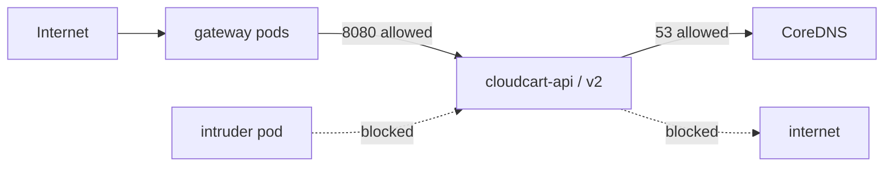

# LAB 07 – Network policies with Cilium

> **Story:** A penetration test showed that *any* pod in the cluster can call CloudCart directly and that CloudCart can talk to the whole internet. Implement zero trust at pod level: only the gateway may reach the API, and the API may only resolve DNS.

| | |
|---|---|
| **Duration** | ~35 min |
| **Builds on** | LAB04/05 (Gateway `cloudcart-gw`) |
| **Files** | `netpol-*.yaml` |

By default Kubernetes allows all pod-to-pod traffic. Our cluster uses the **Cilium dataplane** (LAB02), which enforces standard `NetworkPolicy` objects.



## Step 1 – Baseline: everything is open

```bash
source env.sh
kubectl create namespace intruder
kubectl -n intruder run probe --image=curlimages/curl --command -- sleep 3600
kubectl -n intruder wait --for=condition=Ready pod/probe
kubectl -n intruder exec probe -- curl -s -m 3 http://cloudcart-api.cloudcart.svc.cluster.local | head -3
kubectl -n cloudcart exec deploy/cloudcart-api -- wget -qO- -T 3 https://ifconfig.me; echo
```

Both work. That's the problem.

## Step 2 – Default deny for ingress

```bash
kubectl apply -f labs/LAB07-network-policies/netpol-default-deny.yaml
kubectl -n intruder exec probe -- curl -s -m 3 http://cloudcart-api.cloudcart.svc.cluster.local || echo BLOCKED
curl -s -m 5 https://$APP_HOST/ || echo "gateway BLOCKED too"
```

The intruder is blocked – but so is the public site: the gateway pods also live in `cloudcart` and now receive nothing.

## Step 3 – Allow exactly what is needed

```bash
kubectl apply -f labs/LAB07-network-policies/netpol-allow.yaml
kubectl -n cloudcart get networkpolicy
curl -s https://$APP_HOST/ | grep version                                         # works again
kubectl -n intruder exec probe -- curl -s -m 3 http://cloudcart-api.cloudcart.svc.cluster.local || echo BLOCKED
```

Read `netpol-allow.yaml`: gateway pods accept traffic from anywhere; API pods accept port 8080 **only** from pods labelled `gateway.networking.k8s.io/gateway-name: cloudcart-gw`; cert-manager's ACME solver pods accept traffic from the gateway (otherwise certificate renewals silently break!).

✅ **Checkpoint:** public site OK, intruder `BLOCKED`.

## Step 4 – Restrict egress

```bash
kubectl apply -f labs/LAB07-network-policies/netpol-egress.yaml
kubectl -n cloudcart exec deploy/cloudcart-api -- nslookup kubernetes.default      # DNS works
kubectl -n cloudcart exec deploy/cloudcart-api -- wget -qO- -T 3 https://ifconfig.me || echo "egress BLOCKED"
```

✅ **Checkpoint:** DNS resolves, the internet call fails.

## Step 5 – Observe

```bash
kubectl -n kube-system get pods -l k8s-app=cilium
kubectl -n kube-system exec ds/cilium -- cilium-dbg endpoint list | head -20     # policy enforcement per endpoint
```

With **Advanced Container Networking Services** (`--enable-acns`, paid) you get Hubble flow logs, FQDN-based egress rules (`toFQDNs`) and layer-7 policies.

## Step 6 – Clean up the test namespace

```bash
kubectl delete namespace intruder
```

Keep the policies – the next labs run with them. (The egress policy only selects the API pods; other pods in the namespace are not restricted.)

## Discussion

- Order of work: label strategy → default deny → allow lists. Never the other way round.
- Namespace isolation: `namespaceSelector` with `kubernetes.io/metadata.name`.
- Who owns policies? App teams in their namespaces; platform team via Azure Policy / admission controls.

## Troubleshooting

| Symptom | Likely cause |
|---|---|
| everything still open | cluster without a policy engine (`az aks show --query networkProfile`) |
| site down after allow policy | gateway pod labels differ – `kubectl -n cloudcart get pods --show-labels` |
| certificate renewal fails | solver pods blocked – keep the ACME rule |
| DNS fails after egress policy | CoreDNS selector wrong (`k8s-app: kube-dns` in `kube-system`), or TCP 53 missing |
