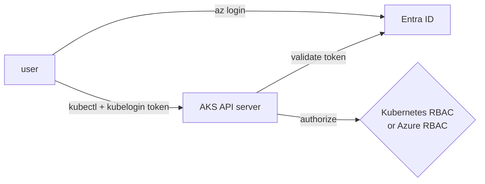

# LAB 09 – Entra ID authentication, Azure RBAC & no local accounts

> **Story:** The auditor's verdict on LAB08: *"Shared certificates with cluster-admin rights are unacceptable."* You connect the cluster to Microsoft Entra ID, manage permissions with Azure RBAC, and switch off local accounts.

| | |
|---|---|
| **Duration** | ~40 min (work in **pairs** for Step 5) |
| **Requires** | an Entra ID group for cluster admins (create it, or ask the trainer) |
| **Files** | `rbac-entra-group.yaml` |

> ⚠️ Enabling Entra ID integration can't be undone on a cluster. That's fine here – it is the production setting.



## Step 1 – Admin group and tools

```bash
source env.sh
MY_ID=$(az ad signed-in-user show --query id -o tsv)

# if you may create groups (otherwise use the group ID from the trainer):
az ad group create --display-name "aks-admins-$PREFIX" --mail-nickname "aks-admins-$PREFIX"
ADMIN_GROUP_ID=$(az ad group show --group "aks-admins-$PREFIX" --query id -o tsv)
az ad group member add --group $ADMIN_GROUP_ID --member-id $MY_ID

kubelogin --version || az aks install-cli        # kubelogin turns Entra tokens into kubectl credentials
```

## Step 2 – Enable Entra ID integration

```bash
az aks update -g $RG -n $CLUSTER --enable-aad --aad-admin-group-object-ids $ADMIN_GROUP_ID
az aks get-credentials -g $RG -n $CLUSTER --overwrite-existing
kubelogin convert-kubeconfig -l azurecli          # reuse your az login, no device code prompt
kubectl get nodes
kubectl auth whoami
```

✅ **Checkpoint:** `kubectl auth whoami` shows **your e-mail / object ID** and your groups – no more `masterclient`.

## Step 3 – Kubernetes RBAC for an Entra group

Kubernetes RBAC works as before – subjects are Entra **object IDs**:

```bash
DEV_GROUP_ID=$ADMIN_GROUP_ID      # in real life: a separate "cloudcart-devs" group
sed "s/<ENTRA-GROUP-OBJECT-ID>/$DEV_GROUP_ID/" labs/LAB09-entra-id-azure-rbac/rbac-entra-group.yaml | kubectl apply -f -
kubectl -n cloudcart get rolebinding cloudcart-developers-entra -o wide
```

## Step 4 – Azure RBAC for Kubernetes authorization

Instead of RoleBindings inside the cluster, permissions can be Azure role assignments – visible and auditable in Azure, assignable at cluster or **namespace** scope:

```bash
az aks update -g $RG -n $CLUSTER --enable-azure-rbac
AKS_ID=$(az aks show -g $RG -n $CLUSTER --query id -o tsv)
az role definition list --query "[?contains(roleName,'Azure Kubernetes Service RBAC')].roleName" -o tsv
```

Built-in roles: *RBAC Reader*, *RBAC Writer*, *RBAC Admin*, *RBAC Cluster Admin*.

## Step 5 – Read access to one namespace for someone else

You are a cluster admin through the admin group, so testing with **your own** account proves nothing. Use a second identity – **5A** with a lab partner, or **5B** on your own.

### 5A – With your neighbour

Your neighbour runs `az ad signed-in-user show --query id -o tsv` on **their** machine and gives you the ID (not your own!). You grant the roles:

```bash
NEIGHBOUR_ID=<neighbour's object id>
az role assignment create --assignee $NEIGHBOUR_ID --role "Azure Kubernetes Service Cluster User Role" --scope $AKS_ID
az role assignment create --assignee $NEIGHBOUR_ID --role "Azure Kubernetes Service RBAC Reader" \
  --scope $AKS_ID/namespaces/cloudcart
echo "az aks get-credentials -g $RG -n $CLUSTER --file ~/.kube/neighbour && kubelogin convert-kubeconfig -l azurecli --kubeconfig ~/.kube/neighbour"
```

Send the printed line to your neighbour. **They** run it in their shell, then:

```bash
kubectl --kubeconfig ~/.kube/neighbour get pods -n cloudcart           # allowed
kubectl --kubeconfig ~/.kube/neighbour get pods -n kube-system         # forbidden
kubectl --kubeconfig ~/.kube/neighbour delete pod --all -n cloudcart   # forbidden
```

### 5B – On your own, with a test service principal

```bash
read SP_APPID SP_SECRET SP_TENANT <<< "$(az ad sp create-for-rbac -n sp-aks-reader-$PREFIX --query '[appId,password,tenant]' -o tsv)"
SP_OID=$(az ad sp show --id $SP_APPID --query id -o tsv)
az role assignment create --assignee-object-id $SP_OID --assignee-principal-type ServicePrincipal \
  --role "Azure Kubernetes Service Cluster User Role" --scope $AKS_ID
az role assignment create --assignee-object-id $SP_OID --assignee-principal-type ServicePrincipal \
  --role "Azure Kubernetes Service RBAC Reader" --scope $AKS_ID/namespaces/cloudcart
sleep 60

export AZURE_CONFIG_DIR=~/.azure-reader          # separate az profile - your own login stays untouched
az login --service-principal --username "$SP_APPID" --password="$SP_SECRET" --tenant "$SP_TENANT" -o none   # "=": secrets may start with "-"
az aks get-credentials -g $RG -n $CLUSTER --file ~/.kube/reader
kubelogin convert-kubeconfig -l azurecli --kubeconfig ~/.kube/reader

kubectl --kubeconfig ~/.kube/reader auth whoami
kubectl --kubeconfig ~/.kube/reader get pods -n cloudcart              # allowed
kubectl --kubeconfig ~/.kube/reader get pods -n kube-system            # forbidden
kubectl --kubeconfig ~/.kube/reader delete pod --all -n cloudcart      # forbidden

unset AZURE_CONFIG_DIR                           # back to your own account
```

(`az ad sp create-for-rbac` fails with *Insufficient privileges* if your tenant doesn't let users register applications – then use 5A.)

✅ **Checkpoint:** read-only, one namespace – managed entirely from Azure. Role assignments can take up to 5 minutes to apply.

## Step 6 – Disable local accounts

```bash
az aks update -g $RG -n $CLUSTER --disable-local-accounts
az aks get-credentials -g $RG -n $CLUSTER --admin --file /tmp/admin2.kubeconfig     # fails now
kubectl get pods -n cloudcart --kubeconfig ~/.kube/anna.kubeconfig                   # Anna from LAB08?
```

Observe and discuss: static admin credentials are gone. What about certificates already issued (Anna)? How would you invalidate them (`az aks rotate-certs`)? What does break-glass access look like now? (an Entra group with PIM, not a stored kubeconfig)

## Troubleshooting

| Symptom | Likely cause |
|---|---|
| `Insufficient privileges to complete the operation` on `az ad group create` | you can't create Entra groups – use the trainer's group |
| browser/device-code prompt on every kubectl call | run `kubelogin convert-kubeconfig -l azurecli` |
| `Forbidden` right after a role assignment | propagation delay (up to 5 min) |
| CI pipeline can't log in after Step 6 | pipelines need an Entra identity too (kubelogin with workload identity / service principal) |
| `stat ~/.kube/neighbour: no such file` | the `echo` only prints the command – your neighbour runs it in their own shell |
| reader can do everything | you tested with your own (admin) account – use a different identity (5A / 5B) |
| `az login`: `argument --password/-p: expected one argument` | the secret starts with `-` or `$SP_SECRET` is empty (new shell) – use `--password="$SP_SECRET"`; new secret: `az ad app credential reset --id $SP_APPID --query password -o tsv` |

Clean up the test identity from 5B when you're done: `az ad app delete --id $SP_APPID`.
