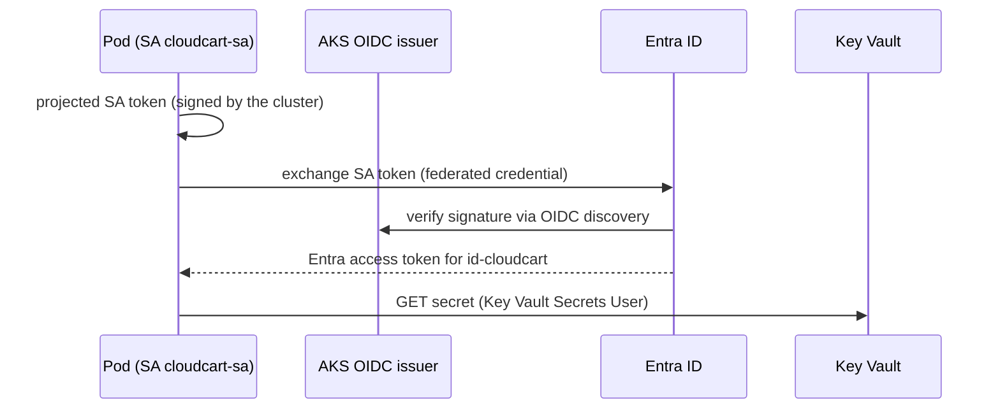

# LAB 10 – Workload Identity & Azure Key Vault

> **Story:** CloudCart needs the database password. Today it sits in a Kubernetes Secret created by hand – base64, not encryption. Move it to **Azure Key Vault** and let the pods authenticate with **Workload Identity**: no client secrets anywhere.

| | |
|---|---|
| **Duration** | ~40 min |
| **Creates** | Key Vault (RBAC), user-assigned managed identity, federated credential |
| **Files** | `serviceaccount.yaml`, `kv-cli-pod.yaml`, `secretproviderclass.yaml`, `deployment-patch.yaml` |



## Step 1 – Key Vault with a secret

```bash
source env.sh
az keyvault create -g $RG -n $KV -l $LOCATION --enable-rbac-authorization true
KV_ID=$(az keyvault show -n $KV --query id -o tsv)
MY_ID=$(az ad signed-in-user show --query id -o tsv)
az role assignment create --assignee $MY_ID --role "Key Vault Secrets Officer" --scope $KV_ID
sleep 30   # role propagation
az keyvault secret set --vault-name $KV -n db-password --value 'CloudCart-$ecret-2026'
```

## Step 2 – Identity for the application

```bash
az identity create -g $RG -n id-cloudcart
export WI_CLIENT_ID=$(az identity show -g $RG -n id-cloudcart --query clientId -o tsv)
WI_PRINCIPAL=$(az identity show -g $RG -n id-cloudcart --query principalId -o tsv)
az role assignment create --assignee-object-id $WI_PRINCIPAL --assignee-principal-type ServicePrincipal \
  --role "Key Vault Secrets User" --scope $KV_ID

OIDC=$(az aks show -g $RG -n $CLUSTER --query oidcIssuerProfile.issuerUrl -o tsv)
az identity federated-credential create -g $RG --identity-name id-cloudcart --name fc-cloudcart \
  --issuer $OIDC --subject system:serviceaccount:cloudcart:cloudcart-sa \
  --audiences api://AzureADTokenExchange
```

The federated credential says: *tokens issued by this cluster for service account `cloudcart/cloudcart-sa` may act as `id-cloudcart`.*

## Step 3 – Service account and a test pod

```bash
envsubst < labs/LAB10-workload-identity-keyvault/serviceaccount.yaml | kubectl apply -f -
envsubst '$KV' < labs/LAB10-workload-identity-keyvault/kv-cli-pod.yaml | kubectl apply -f -   # only $KV - the $AZURE_* vars are for the pod
kubectl -n cloudcart get pod kv-cli -o jsonpath='{.spec.containers[0].env[*].name}'; echo
kubectl -n cloudcart logs -f kv-cli
```

✅ **Checkpoint:** the webhook injected `AZURE_CLIENT_ID`, `AZURE_TENANT_ID`, `AZURE_FEDERATED_TOKEN_FILE`, and the log ends with the secret value read from Key Vault. No password, no client secret.

## Step 4 – Mount secrets as files (Secrets Store CSI driver)

```bash
az aks enable-addons -g $RG -n $CLUSTER -a azure-keyvault-secrets-provider
kubectl -n kube-system get pods -l app=secrets-store-csi-driver
export TENANT_ID=$(az account show --query tenantId -o tsv)
envsubst < labs/LAB10-workload-identity-keyvault/secretproviderclass.yaml | kubectl apply -f -
kubectl -n cloudcart patch deploy cloudcart-api --patch-file labs/LAB10-workload-identity-keyvault/deployment-patch.yaml
kubectl -n cloudcart rollout status deploy/cloudcart-api
kubectl -n cloudcart exec deploy/cloudcart-api -- ls /mnt/secrets
kubectl -n cloudcart exec deploy/cloudcart-api -- cat /mnt/secrets/db-password; echo
curl -s https://$APP_HOST/ | grep -A2 secrets
```

✅ **Checkpoint:** `/mnt/secrets/db-password` exists in the API pods, and the API lists it in its JSON output.

## Step 5 – Rotate the secret

```bash
az keyvault secret set --vault-name $KV -n db-password --value 'Rotated-2026-11'
```

The CSI driver re-reads secrets on pod start (and periodically if *secret rotation* is enabled on the add-on: `az aks addon update -g $RG -n $CLUSTER -a azure-keyvault-secrets-provider --enable-secret-rotation`). Restart the deployment and check the file again.

## Discussion

- Workload Identity replaced the deprecated *AAD Pod Identity*. What changed? (no NMI DaemonSet, standard OIDC federation)
- One identity per app, least privilege on resource scope.
- The same mechanism lets pods use Storage, Service Bus, SQL with Entra auth – no connection-string secrets at all.

## Troubleshooting

| Symptom | Likely cause |
|---|---|
| `AADSTS70021: No matching federated identity record found` | subject (`namespace:serviceaccount`) or issuer URL mismatch |
| `Forbidden … does not have secrets get permission` | role assignment missing or not propagated yet |
| no `AZURE_*` env vars in the pod | pod label `azure.workload.identity/use: "true"` missing, or wrong service account |
| CSI mount `failed to get keyvault client` | wrong `clientID`/`tenantId`/`keyvaultName` in the SecretProviderClass |
