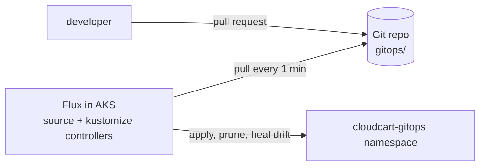

# LAB 13 – GitOps with Flux (AKS extension)

> **Story:** Changes made with `kubectl apply` from laptops are not reviewable, not repeatable and drift silently. From now on, Git is the single source of truth for the `cloudcart-gitops` namespace – Flux pulls and reconciles it.

| | |
|---|---|
| **Duration** | ~40 min |
| **Requires** | a GitHub account (public fork of this repository) |
| **Files** | `gitops/` folder in the repository root |



## Step 1 – Fork and point the manifests at your registry

1. Fork this repository on GitHub (public), clone **your fork**.
2. Replace the registry placeholder and push:

   ```bash
   source env.sh
   sed -i "s/ACR_NAME/$ACR/" gitops/apps/cloudcart/deployment.yaml
   git add gitops && git commit -m "Use my ACR" && git push
   ```

Look at the structure:

```
gitops/
├── apps/cloudcart/          namespace, deployment, service, kustomization.yaml
└── infrastructure/          shared config (quota for the namespace)
```

## Step 2 – Install Flux as an AKS extension

```bash
az extension add --name k8s-configuration --upgrade
az extension add --name k8s-extension --upgrade
az k8s-extension create -g $RG -c $CLUSTER -t managedClusters \
  --name flux --extension-type microsoft.flux
kubectl -n flux-system get pods
```

✅ **Checkpoint:** `source-controller`, `kustomize-controller`, `helm-controller`, `notification-controller` running.

## Step 3 – Connect the cluster to your Git repository

```bash
GIT_URL=https://github.com/<your-user>/<your-fork>
az k8s-configuration flux create -g $RG -c $CLUSTER -t managedClusters \
  --name cloudcart-gitops --namespace flux-system --scope cluster \
  --url $GIT_URL --branch main \
  --kustomization name=infra path=./gitops/infrastructure prune=true \
  --kustomization name=apps path=./gitops/apps depends_on=\["infra"\] prune=true

az k8s-configuration flux show -g $RG -c $CLUSTER -t managedClusters -n cloudcart-gitops --query complianceState
kubectl get gitrepositories,kustomizations -A
kubectl -n cloudcart-gitops get all
```

✅ **Checkpoint:** compliance state `Compliant`, the `cloudcart-gitops` namespace and its deployment were created from Git.

## Step 4 – Change through Git

Edit `gitops/apps/cloudcart/deployment.yaml` in your fork: `replicas: 3`, `APP_VERSION` → `"1.1"`. Commit and push (or edit on GitHub). Within about a minute:

```bash
kubectl -n cloudcart-gitops get deploy cloudcart -w
```

## Step 5 – Drift is healed automatically

```bash
kubectl -n cloudcart-gitops scale deploy cloudcart --replicas=1
kubectl -n cloudcart-gitops delete svc cloudcart
sleep 90
kubectl -n cloudcart-gitops get deploy,svc
```

✅ **Checkpoint:** replicas back to 3, the Service is back – the cluster matches Git again.

## Step 6 – Prune

Delete `service.yaml` from `gitops/apps/cloudcart/kustomization.yaml` (and the file), push. With `prune=true` Flux removes the Service from the cluster. Restore it afterwards.

## Discussion

- Push (CI runs `kubectl`/`helm`) vs. pull (GitOps): credentials, audit, drift.
- Multiple environments: `clusters/dev`, `clusters/prod` with Kustomize overlays; Helm releases via `HelmRelease`.
- Secrets in Git: SOPS with Azure Key Vault keys, or reference Key Vault directly (LAB10).
- Flux vs. Argo CD.

## Clean up

```bash
az k8s-configuration flux delete -g $RG -c $CLUSTER -t managedClusters -n cloudcart-gitops --yes
```

## Troubleshooting

| Symptom | Likely cause |
|---|---|
| `NonCompliant`, *authentication required* | private fork – make it public or add `--https-user/--https-key` |
| kustomization `path not found` | path is relative to the repo root (`./gitops/apps`) |
| `ImagePullBackOff` in `cloudcart-gitops` | the `ACR_NAME` placeholder wasn't replaced |
| changes not applied | wrong branch, or the interval hasn't passed – `kubectl -n flux-system get gitrepositories` |
