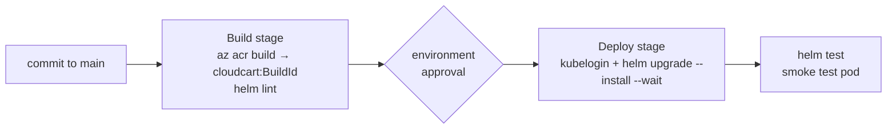

# LAB 14 – CI/CD: from commit to AKS with Helm

> **Story:** Every merge to `main` must build a new image, deploy it to AKS and prove it works – with no stored passwords. You build the pipeline in **Azure DevOps** (or GitHub Actions, if your team lives there).

| | |
|---|---|
| **Duration** | ~45 min |
| **Requires** | an Azure DevOps project **or** a GitHub fork |
| **Files** | `charts/cloudcart/`, `pipelines/azure-pipelines.yml`, `pipelines/github-actions-deploy.yml` |



## Step 1 – Look at the chart

```bash
source env.sh
helm lint charts/cloudcart
helm template demo charts/cloudcart --set image.repository=$ACR.azurecr.io/cloudcart | less
```

`templates/tests/smoke-test.yaml` is a Helm **test hook**: `helm test` starts a pod that calls the Service and checks the returned version.

Create the target namespace as cluster admin (the pipeline identity only gets namespace rights):

```bash
kubectl create namespace cloudcart-cicd
```

## Track A – Azure DevOps

### A1 – Repository and service connection

1. Import this repository into **Azure Repos** (or connect your GitHub fork).
2. **Project settings → Service connections → New → Azure Resource Manager → Workload identity federation (automatic)**, scope: resource group `$RG`, name **`sc-aks-lab`**. No secret is created – Azure DevOps gets federated tokens.
3. Find the identity behind it: *Manage service connection roles* opens it in Entra ID – copy its **Object ID**.

### A2 – Permissions (least privilege)

```bash
SC_ID=<object id of the service connection identity>
ACR_ID=$(az acr show -n $ACR --query id -o tsv)
AKS_ID=$(az aks show -g $RG -n $CLUSTER --query id -o tsv)

az role assignment create --assignee-object-id $SC_ID --assignee-principal-type ServicePrincipal --role Contributor --scope $ACR_ID           # run ACR Tasks
az role assignment create --assignee-object-id $SC_ID --assignee-principal-type ServicePrincipal --role "Azure Kubernetes Service Cluster User Role" --scope $AKS_ID
az role assignment create --assignee-object-id $SC_ID --assignee-principal-type ServicePrincipal --role "Azure Kubernetes Service RBAC Writer" --scope $AKS_ID/namespaces/cloudcart-cicd
```

### A3 – Pipeline

Edit `pipelines/azure-pipelines.yml`: set `acrName`, `resourceGroup`, `clusterName`. Commit.

**Pipelines → New pipeline → (your repo) → Existing Azure Pipelines YAML file → `/pipelines/azure-pipelines.yml` → Run.**

✅ **Checkpoint:** both stages green; the log of `helm test` shows `Phase: Succeeded`.

```bash
kubectl -n cloudcart-cicd get deploy,pods
helm -n cloudcart-cicd history cloudcart
```

### A4 – Gate production

**Pipelines → Environments → cloudcart-lab → Approvals and checks → Approvals** – add yourself. Change `title` in `charts/cloudcart/values.yaml`, push: the Deploy stage waits for your approval.

## Track B – GitHub Actions

1. Copy `pipelines/github-actions-deploy.yml` to `.github/workflows/deploy.yml` in your fork.
2. Create an identity with a federated credential for your repository (environment `cloudcart-lab`):

   ```bash
   az identity create -g $RG -n id-github-deploy
   GH_PRINCIPAL=$(az identity show -g $RG -n id-github-deploy --query principalId -o tsv)
   az identity federated-credential create -g $RG --identity-name id-github-deploy --name github-cloudcart \
     --issuer https://token.actions.githubusercontent.com \
     --subject "repo:<your-user>/<your-fork>:environment:cloudcart-lab" \
     --audiences api://AzureADTokenExchange
   ```

3. Grant the same three roles as in A2 to `$GH_PRINCIPAL`.
4. Repository **secrets** `AZURE_CLIENT_ID` (`az identity show … --query clientId`), `AZURE_TENANT_ID`, `AZURE_SUBSCRIPTION_ID`; **variables** `ACR_NAME`, `RESOURCE_GROUP`, `CLUSTER_NAME`.
5. **Actions → Build and deploy CloudCart → Run workflow.**

## Step 2 – Roll back

```bash
helm -n cloudcart-cicd history cloudcart
helm -n cloudcart-cicd rollback cloudcart 1
```

## Discussion

- Push-based CI/CD (this lab) vs. GitOps (LAB13): combine them – CI builds the image and updates Git, Flux deploys.
- Image tags: build ID vs. Git SHA vs. semantic versions; never `latest`.
- Add quality gates before deploy: unit tests, image scan (Defender / Trivy), policy checks.

## Troubleshooting

| Symptom | Likely cause |
|---|---|
| `AuthorizationFailed … scheduleRun` | the identity lacks rights on the ACR |
| `Forbidden … secrets is forbidden` during helm | RBAC Writer missing on the namespace, or propagation delay |
| pipeline hangs at device login | `kubelogin convert-kubeconfig -l azurecli` missing (Entra-enabled cluster) |
| `helm test` fails | the new pods aren't ready, or `appVersion` mismatch – check `kubectl -n cloudcart-cicd logs cloudcart-smoke-test` |
